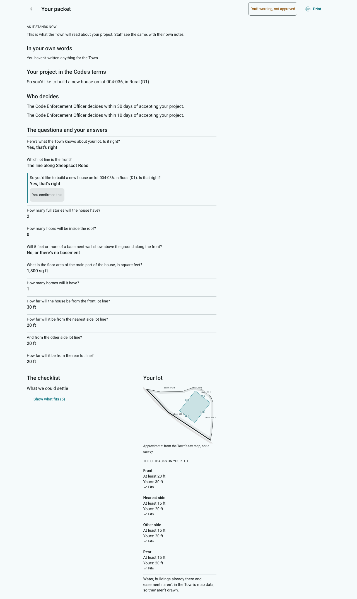
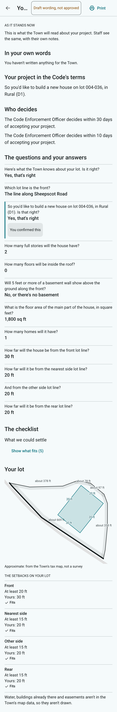

# MEMORANDUM

**To:** Ben Frey, Planning Board chair
**From:** Applicant Portal build (guided builder, plan 6)
**Date:** November 6, 2026
**Re:** The applicant's packet: its new words, for approval
**Status:** **For approval.** The packet is built (`portal-guided-6-packet`). You can see it on the LAN copy: walk a project with "Try the guided version (preview)", then open "Your packet".

---

The design (`specs/2026-11-06-applicant-portal-guided-builder-packet.md`, approved 2026-11-06)
shows each resident the packet the Town will read. It has four parts, in the order of §7:
- their own words;
- the project in the Code's terms, and who decides;
- the questions and answers, with the moments that matter marked;
- the checklist (judgment first) and the lot drawing.

The packet reuses every approved word it can: "What goes to the Town", "Fits", the reasons, the
drawing's rows and the decision sentences. The words below are new, and they are drafts until you
approve them.

## 1. The packet

{width=80%}

{width=45%}

## 2. The new words (all drafts)

| Where | Applicants read |
|:---|:---|
| The page's title, and its links | Your packet |
| Under the title | This is what the Town will read about your project. Staff see the same, with their own notes. |
| Before sending | As it stands now |
| After sending | As sent on {date} |
| Before the conversation ends | The conversation isn't finished, so this shows what's settled so far. |
| Part 1 | In your own words |
| When there are none | You haven't written anything for the Town. |
| Part 2 | Your project in the Code's terms |
| Part 3 | Who decides |
| When no review is settled | The Town decides which review your project needs. |
| Part 4 | The questions and your answers |
| Marks | You confirmed this · You took the suggestion · You kept your number · *(and the approved "I'm not sure yet")* |
| Part 5 | The checklist |
| The fold | Show what fits ({n}) · Hide what fits |
| Each row's limit | Required: … |
| Part 6 | Your lot |
| No outline | The Town's tax map has no outline for this lot, so there is no drawing. |
| The app bar | Print |

## Decisions for the chair

1. **The words** in section 2, as drafted.
2. **The intro's promise.** "Staff see the same, with their own notes" says what design 4 will build.
   Should it wait until staff notes exist?
3. **A project changed after sending.** A sent project stays editable until staff lock it, but the
   packet shows it "as sent". Someone who changes a setback after sending would see the old number
   until they send again. Options:
   - mark the packet "changed since you sent it" (new words);
   - keep it as is, since sending again replaces it.
4. **Who decides, where a review has no decision sentence** (a subdivision, an entrance permit):
   the packet shows the review's name and its approved reviewer, for example "Subdivision Review:
   Planning Board", rather than adding new words. A "you don't need a permit" ending shows its own
   title there.
