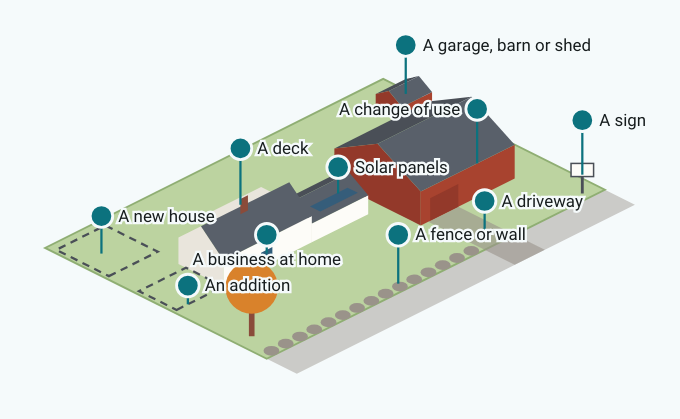
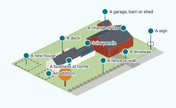
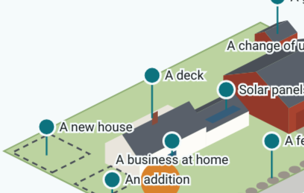
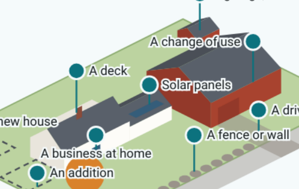
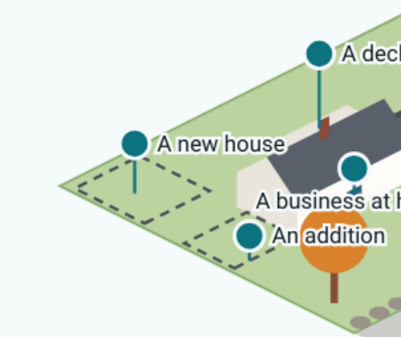
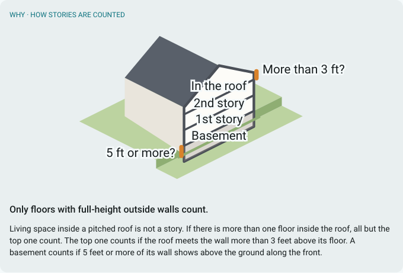

# MEMORANDUM

**To:** Ben Frey, Planning Board chair
**From:** Applicant Portal build (guided builder, plan 5)
**Date:** November 6, 2026
**Re:** The pictures: sample sheet, for approval (decision 15)
**Status:** **Approved by the chair on 2026-11-06** (see "The chair's decisions"). You can see it working on the LAN copy: open any project, then "Try the guided version (preview)".

---

## The chair's decisions (2026-11-06)

Taken in interview on 2026-11-06.

1. **Palette and look:** approved as shown.
2. **The buildings:** approved. The cape, its ell and the red barn read as Newcastle.
3. **The pins and their places:** approved as shown, including the three moves made for phones.
4. **The stories picture:** one cut-away, as shown.
5. **The words** in section 4 and the stories picture's description: approved as written.
6. **The setbacks picture:** to be drawn to match. It shows the house on the lot, with arrows
   from each lot line to the nearest part of the house, labelled with the drawing's
   already-approved row names ("Front", "Nearest side", "Other side", "Rear") and no distances.
   Its description comes back to the chair as a draft.
7. **Two screen-reader descriptions**, raised by the branch review and approved as written:
   - the scene's: "A Newcastle lot with a cape, its ell and a barn, a stone wall and a maple. Tap a
     project, or choose one from the list below.";
   - the setbacks picture's: "A house on its lot, with an arrow from each lot line to the nearest
     part of the house: the front, the nearest side, the other side and the rear. Each setback is
     measured along its arrow."

The design (`specs/2026-11-06-applicant-portal-guided-builder-pictures.md`, approved 2026-11-06)
calls for one opening scene of a Newcastle lot, seen from above at an angle, and explanation
pictures in the same view. This sheet shows the whole scene and its ten places to tap, three of
them close up, and the "how stories are counted" cut-away. Each comes with the words applicants
read and a screen reader hears. Once you approve, the setbacks picture is drawn to match, along
with any changes you ask for.

## 1. The opening scene

{width=70%}

**What a screen reader hears:** "A Newcastle lot with a cape, its ell and a barn, a stone wall and
a maple. Tap a project, or choose one from the list below."

**What's in it.**

- A white cape with a centre chimney, its ell and a red barn, in a row along the road.
- A stone wall along the road, with a gap for the drive.
- A maple at the front corner and a shed out back.
- Two dashed outlines: where a new house could go (back left) and an addition (off the cape's west
  side).
- One palette for every picture: white clapboard, barn red, roof grey, lot green, stone grey,
  maple orange, door blue, chimney brick.

**The ten places to tap**, in the order the list under the scene shows them:

| Pin | Stands over | What a tap does today |
|:---|:---|:---|
| A new house | the dashed outline, back left | starts the conversation (adds a building first, if the project has none) |
| A change of use | the barn | starts the conversation (adds a use first, if the project has none) |
| An addition | the dashed outline off the cape | "coming soon" |
| A deck | the deck behind the cape | "coming soon" |
| Solar panels | panels on the ell's roof | "coming soon" |
| A garage, barn or shed | the shed out back | "coming soon" |
| A driveway | the drive | "coming soon" |
| A fence or wall | the stone wall | "coming soon" |
| A sign | the sign by the road | "coming soon" |
| A business at home | the small sign by the cape's door | "coming soon" |

**Three moves from the design, made so every pin can be tapped on a phone.** Ten pins on a phone's
width need room, so three things moved from where the design put them:

- the new-house outline goes back left (not back right, where the barn hid it);
- the solar panels go on the ell's roof (not the barn's);
- the business-at-home sign goes by the cape's door (not the ell's).

On a 390 px phone every pin's target is 48 px across and clear of the others. On the smallest
phones (320 px) the targets still measure 48 px, but their centres are 40 px apart, so neighbours
overlap a little. The list under the scene is always there as well.

On a phone the pins' names are small, about 8 px. They're there to help people find the pins; the
list under the scene gives the same names at full size.

## 2. Close-ups

{width=32%} {width=32%} {width=32%}

## 3. "How stories are counted"

{width=60%}

The scene's cape is shown with its gable end facing the road and cut open:

- the floors are marked, with the two tests where the Code measures them;
- the knee wall carries the label "More than 3 ft?";
- the basement wall that shows above the lowered front ground carries "5 ft or more?".

The picture has no numbers of its own.

**What a screen reader hears:** "A house cut open to show its floors. The first and second floors
have full-height walls and count as stories. A floor inside the roof counts only if the roof meets
its wall more than 3 feet above the floor. A basement counts if 5 feet or more of its wall shows
above the ground along the front."

## 4. The new words (approved 2026-11-06)

| Where | Applicants read |
|:---|:---|
| Above the scene | What would you like to do? *(approved 2026-11-06)* |
| The box beside it | In your own words, what would you like to do? (optional) |
| Above the list | Or choose from the list |
| "Add" question | Add {project} to this project? |
| Under it | Your project doesn't have this yet. Adding it adds its questions to your project's form. |
| Its buttons | Add it · Not now |
| "Coming soon" | {Project}: coming soon |
| Under it | The guide can't walk you through this yet. You can still fill in your project's form, or contact the Town Office. |
| Its button | OK |
| The eight new pins | An addition · A deck · Solar panels · A garage, barn or shed · A driveway · A fence or wall · A sign · A business at home |
| The cut-away's labels | 1st story · 2nd story · In the roof · Basement · More than 3 ft? · 5 ft or more? |

## Decisions for the chair

1. **The palette and the look.** Approve them as shown, or say what to change.
2. **The buildings.** Do the cape, its ell and the red barn in a row read as Newcastle?
3. **The pins and their places.** That includes the three moves above.
4. **The stories picture.** Should it be one cut-away, as shown, or three views shown in turn? This
   is the design's open question (§7).
5. **The words** in section 4, as drafted.
